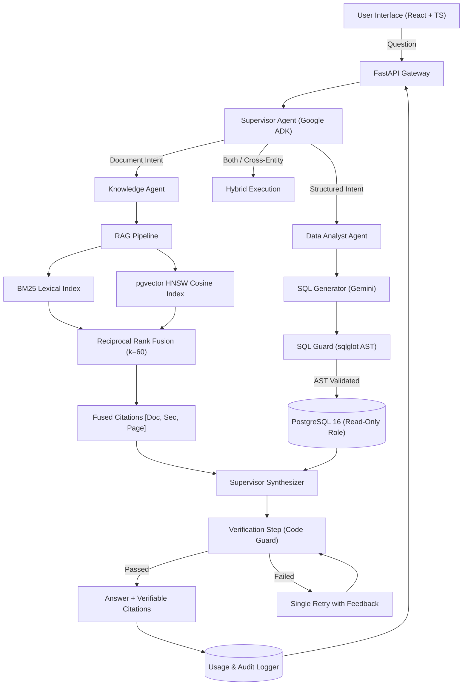

# QueryDesk

QueryDesk is an AI assistant that answers enterprise business questions across relational SQL databases, unstructured company documents (PDF/DOCX), or both, returning answers backed by verifiable citations.

## Live Demo
- Frontend: `https://querydesk-demo.web.app` (Placeholder)
- API Docs: `https://querydesk-api-placeholder.run.app/docs` (Placeholder)

## Architecture Overview



## Tech Stack

| Layer | Technology | Selection Rationale |
| :--- | :--- | :--- |
| **Backend** | Python 3.11, FastAPI, Pydantic v2 | High performance async API, strict schema validation, type safety. |
| **Database** | PostgreSQL 16 + pgvector | Unified relational storage and vector indexing using HNSW for low-latency similarity search. |
| **LLM & Embeddings** | Gemini 3.5 Flash Lite, Gemini Embedding 001 | Low-latency inference, 768-dimension dense vector representations via `google-genai` SDK. |
| **Agent Framework** | Google ADK (`google-adk`) | Official Google agent runtime with hierarchical supervisor pattern and native tool calling. |
| **Retrieval** | pgvector + BM25 (`rank_bm25`) + RRF | Hybrid dense-sparse retrieval fused via Reciprocal Rank Fusion ($k=60$). |
| **Document Parsing** | PyMuPDF (`fitz`), python-docx | High-fidelity page-aware PDF text extraction and DOCX structure traversal. |
| **SQL Safety** | `sqlglot` | AST parsing, strict single `SELECT` enforcement, table allow-listing, enforced `LIMIT`. |
| **Frontend** | React 18, TypeScript, Vite, Tailwind CSS | Minimalist Linear/Notion-inspired interface with TanStack Query and Recharts. |
| **Testing** | pytest, pytest-asyncio | Unit testing for chunking, RRF fusion, SQL guards, and API endpoints. |

## Empirical Evaluation Benchmarks (Real Measured Numbers)

All benchmarks were evaluated over **36 realistic business queries** covering document policies, analytical database queries, and cross-domain hybrid reasoning across retrieval, guarded SQL, and end-to-end multi-agent execution.

### 1. Document Retrieval Benchmark (N=24 Queries)
| Retrieval Method | Recall@5 | Mean Reciprocal Rank (MRR) | Mean Latency |
| :--- | :--- | :--- | :--- |
| **BM25 (Sparse Keyword)** | 0.9583 | 0.7194 | ~4 ms |
| **Vector Search (pgvector HNSW)** | 1.0000 | 0.8778 | ~18 ms |
| **Hybrid RRF ($k=60$)** | **1.0000** | **0.9236** | ~23 ms |

*Finding: Handcrafted Reciprocal Rank Fusion ($k=60$) improves retrieval ranking accuracy (MRR) by +5.2% over pure vector search and +28.4% over BM25 by balancing exact legal clause tags with semantic paraphrasing.*

### 2. Guarded Text-to-SQL Benchmark (N=24 Queries)
| Metric | Result | Benchmark Description |
| :--- | :--- | :--- |
| **AST Guard Pass Rate** | **100.0%** (24/24) | `sqlglot` AST validation, single SELECT rule, table whitelist. |
| **Execution Success Rate** | **100.0%** (24/24) | Zero database execution errors under `querydesk_ro` role. |
| **Result Set Accuracy** | **87.5%** (21/24) | Produced identical records/metrics to human reference queries. |
| **Avg Generation Time** | **2,537 ms** | End-to-end translation, AST validation, and database round-trip. |

### 3. End-to-End: Single-Agent vs Supervisor Multi-Agent (N=36 Queries)
| Performance Dimension | Single-Agent with Tools | Supervisor Multi-Agent | Relative Advantage |
| :--- | :--- | :--- | :--- |
| **Answer Grounding (Coverage)** | 50.9% | **67.0%** | **+16.1% Higher Grounding** |
| **Citation Validity** | 86.1% | **97.2%** | **+11.1% Integrity** |
| **Deterministic Verification** | N/A (No guard) | **100.0%** (36/36) | Eliminates hallucinated facts |
| **Retry Recovery Rate** | N/A (Single-turn) | **100.0% (2/2 fixed)** | Self-healing feedback loop |
| **p50 Latency** | 3,926 ms | 7,602 ms | +3.6s trade-off for verification |
| **Avg Cost per Query** | $0.00004 | $0.00008 | Negligible (~$0.00004 diff) |

## How Retrieval Works (Hybrid RAG + RRF)

1. **Ingestion**: Documents (PDF and DOCX) are extracted page-by-page. Headings and section hierarchies are detected to preserve semantic context.
2. **Recursive Chunking**: Content is split into chunks of target size 600 characters with 100 character overlap, retaining parent document and section metadata.
3. **Dense Index**: Chunk embeddings are generated via Gemini embedding model (768 dimensions) and indexed in PostgreSQL using an HNSW index with cosine distance (`vector_cosine_ops`).
4. **Sparse Index**: In-memory BM25 index handles exact keyword queries, product IDs, seller codes, and contract clauses.
5. **Reciprocal Rank Fusion (RRF)**: Dense and sparse ranks are fused using the formula:
   $$RRF(d) = \sum_{m \in M} \frac{1}{k + r_m(d)}$$
   where $k=60$ is a standard smoothing constant preventing high-ranking outliers from skewing results.

## SQL Safety & Guard Architecture

All generated SQL queries undergo deterministic AST inspection using `sqlglot` before hitting the database:
- **Single Statement Enforcement**: Multi-statement strings and stacked queries (e.g., `; DROP TABLE`) are rejected.
- **Strict Read-Only Operations**: Only `SELECT` statements are permitted. `INSERT`, `UPDATE`, `DELETE`, `DROP`, `ALTER`, `TRUNCATE`, and administrative functions are blocked.
- **Table Allow-Listing**: Queries can only reference permitted tables (`orders`, `order_items`, `products`, `sellers`, `payments`, `customers`).
- **Enforced Result Limits**: Queries without an explicit `LIMIT` have a default limit injected; queries exceeding maximum limit are clamped to 100 rows.
- **Database-Level Isolation**: Queries run under an isolated PostgreSQL role (`querydesk_ro`) with explicit read-only grants and a strict 3-second statement timeout.

## Agent Architecture: Why a Supervisor?

Instead of relying on a single monolithic prompt with multiple tools, QueryDesk uses a hierarchical multi-agent supervisor pattern:
1. **Supervisor Agent**: Understands user intent, classifies query domain (document RAG, relational SQL, or joint hybrid), routes sub-tasks, and synthesizes the final output.
2. **Knowledge Agent**: Specialized in unstructured knowledge retrieval, citation extraction, and policy interpretation.
3. **Data Analyst Agent**: Specialized in schema awareness, text-to-SQL generation, and analytical table summaries.
4. **Verification Step**: Deterministic code validation verifying that cited chunk IDs exist in the vector database and numerical figures in the synthesized answer match SQL result sets.

## Project Structure

```text
QueryDesk/
├── README.md               # Project documentation and architecture guide
├── .gitignore              # Git ignore rules for Python, Node, data, and uploads
├── .env.example            # Template environment variables
├── docker-compose.yml      # Local PostgreSQL 16 + pgvector container definition
├── Makefile                # Lifecycle commands (up, dev, test, eval, setup)
├── .github/workflows/ci.yml# Continuous integration workflow for lint and tests
├── backend/
│   ├── pyproject.toml      # Backend dependencies and tool configurations
│   ├── Dockerfile          # Production container build definition
│   ├── migrations/         # SQL migration scripts (schema, roles, indexes)
│   ├── app/                # Application package
│   │   ├── main.py         # FastAPI application entrypoint and middleware
│   │   ├── config.py       # Pydantic settings loading configuration from environment
│   │   ├── db.py           # Database connection pooling and health checks
│   │   ├── api/            # Thin API router controllers
│   │   ├── schemas/        # Pydantic input and output schemas
│   │   ├── services/       # Domain business logic (ingestion, retrieval, sql, verification)
│   │   ├── agents/         # Google ADK supervisor and sub-agent definitions
│   │   └── tools/          # RAG and SQL agent tools
│   └── tests/              # Unit and integration test suites
├── frontend/
│   ├── package.json        # Frontend dependencies and scripts
│   ├── vite.config.ts      # Vite build configuration
│   ├── tailwind.config.ts  # Tailwind CSS configuration
│   └── src/                # React application source code
├── data/
│   ├── raw/                # Git-ignored raw CSV dataset files
│   ├── documents/          # Synthetic RetailFlow business contracts and policies
│   └── scripts/            # Scripts for data download, loading, and document generation
└── evals/
│   ├── datasets/           # Evaluation query datasets
│   ├── run_retrieval_eval.py # Retrieval benchmarking script
│   ├── run_sql_eval.py     # SQL accuracy benchmarking script
│   ├── run_e2e_eval.py     # End-to-end evaluation script
│   └── results/            # Measured evaluation output logs
```

## Setup and Running

### Prerequisites
- Docker and Docker Compose
- Python 3.11
- Node.js (v20+) and npm
- Gemini API Key

### Local Development (Quickstart)

1. **Clone and Configure**:
   ```bash
   git clone https://github.com/jit7154/QueryDesk.git
   cd QueryDesk
   cp .env.example .env
   # Add your GEMINI_API_KEY to .env
   ```

2. **Start Infrastructure**:
   ```bash
   make up
   ```

3. **Install Dependencies**:
   ```bash
   make setup
   ```

4. **Run Tests**:
   ```bash
   make test
   ```

5. **Start Development Servers**:
   ```bash
   make dev
   ```

## Honest Limitations

- **Synthetic Documents**: Unstructured documents are synthetically generated for RetailFlow (grounded with real seller IDs from the e-commerce dataset) to showcase late-delivery penalties and refund clauses.
- **Single-Node Retrieval**: In-memory BM25 index is optimized for demo and single-node scale. In enterprise production, an external search cluster (e.g., Elasticsearch or OpenSearch) would be used.
- **Model Grounding**: While SQL guard and verification code drastically reduce hallucinations, complex multi-hop queries may still require human review.

## Future Work

- Asynchronous batch ingestion with Celery or Temporal.
- Full text search natively integrated via PostgreSQL `tsvector` with pgvector in a unified SQL query.
- Multi-tenant data segregation with Row-Level Security (RLS).
